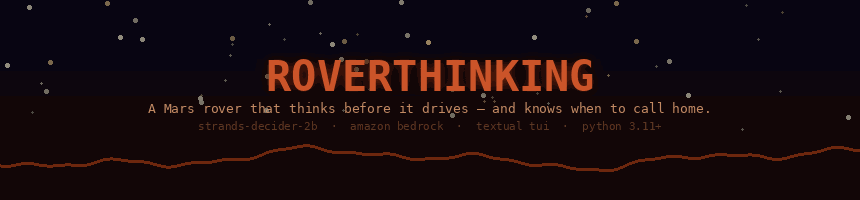
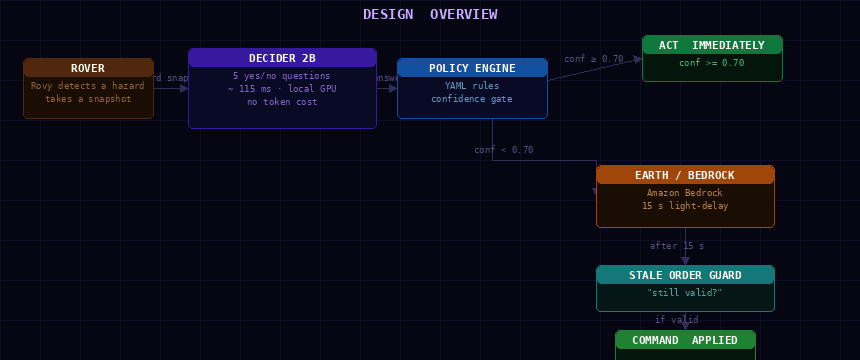
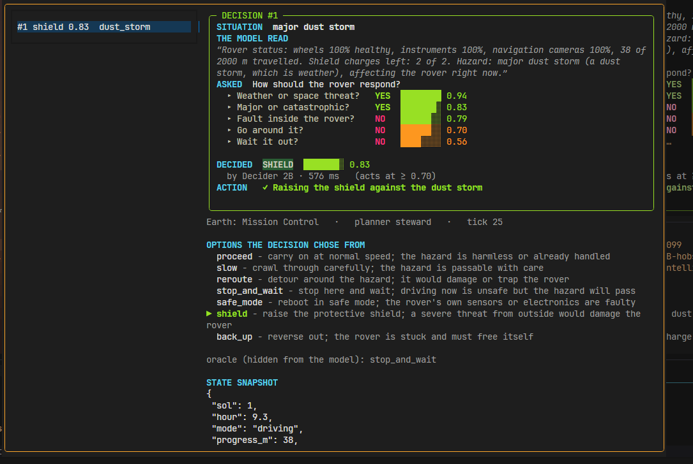
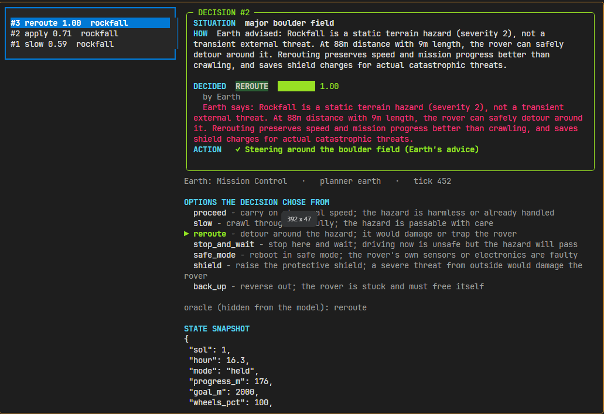

<div align="center">



[](https://www.python.org/)
[](https://aws.amazon.com/bedrock/)
[](https://huggingface.co/StrandsAgents/strands-decider-2B-hobson-v19)
[](https://textual.textualize.io/)
[](https://docs.astral.sh/uv/)
[](tests/)
[](LICENSE)

</div>

Roverthinking is an autonomous rover **agent** that runs in your terminal. A
tiny rover named **Rovy** navigates across Mars terrain, hitting dust storms,
rockfalls, solar flares, and strange rocks. Every hazard triggers a real AI
decision: Strands Decider 2B is asked five typed yes/no questions about the
situation — in about 115 ms, on a laptop GPU — and its answers are turned into
an action. When Decider isn't confident enough and waiting is safe, Rovy stops
and escalates to **Earth** (Amazon Bedrock). Earth replies after a simulated
light-delay. A stale-order guard checks the answer before it is applied.

The Mars run is the environment the agent acts in — a live simulation you can
drive from the keyboard — so you can watch the same decision fire dozens of
times and measure how well it holds up.

The reusable asset is a YAML-driven decision framework — `decider_framework` —
that any Strands agent can use in two lines of Python.

---

## Design overview

<div align="center">

</div>

Every hazard fires a batch of yes/no questions at **Strands Decider 2B** (running locally, ~115 ms). A **Policy Engine** matches the answers against YAML rules and checks the confidence score. If confidence is high enough the rover acts immediately. If it is low *and* waiting is safe, the request is queued for **Earth** — an Amazon Bedrock call that returns after a simulated 15-second light-delay. A **Stale Order Guard** re-asks Decider whether the situation has changed before the command is applied; commands that no longer make sense are dropped silently.

---

> **Hackathon submission** — AWS Builder Center · Agent Experience Hackathon: Strands Decider 2B
> This is an independent open-source project. Not affiliated with or endorsed by AWS or Strands.

---

## Submission details

| Field | Value |
|---|---|
| **Hackathon** | AWS Builder Center · Strands Decider 2B Agent Experience |
| **Decision patterns** | Model routing (`#model-routing`) · Guardrails (`#guardrails`) |
| **Tags** | `#strands-decider-2b` `#model-routing` |
| **Earth model** | `us.anthropic.claude-haiku-4-5-20251001-v1:0` via Amazon Bedrock |
| **Decider checkpoint** | `StrandsAgents/strands-decider-2B-hobson-v19` |
| **Tests** | 92 passing (offline) |
| **License** | MIT |
| **Author** | Rahul Rajasekharan · London |

---

## Table of contents

1. [Why a rover agent?](#1-why-a-rover-agent)
2. [Design overview](#design-overview)
3. [How the decisions work](#3-how-the-decisions-work)
4. [The reusable framework](#4-the-reusable-framework)
5. [The two recipe patterns](#5-the-two-recipe-patterns)
6. [What the rover does](#6-what-the-rover-does)
7. [Measured results](#7-measured-results)
8. [Quick start](#8-quick-start)
9. [Project layout](#9-project-layout)

---

## 1. Why a rover agent?

The brief said: *use Decider 2B for a meaningful decision*. An agent where the
same decision fires dozens of times per run — with ground-truth outcomes you
can measure — felt like the right way to actually stress-test a decision model
rather than demo one.

Mars also gave me a concrete real-world constraint: a real Mars rover cannot
ask mission control every time it hits a pebble. It needs to decide locally,
fast. But for genuinely ambiguous situations it needs a human (or at least a
frontier model) in the loop — after the light-delay. That constraint maps
directly onto the act-or-escalate pattern, and it makes the latency number
*matter*.

---

## 2. How the decisions work

Every hazard Rovy detects triggers a **batch decision call** to Decider 2B.
Six typed yes/no questions are sent in a single request, sharing one encoded
state:

| Question | What it resolves |
|---|---|
| Is this a weather or space threat? | External vs. terrain |
| Is the threat severe? | Severity classification |
| Can Rovy go around it? | Bypass feasibility |
| Does the rover need to stop and wait? | Safe-mode trigger |
| Is the rover's instrument needed here? | Science opportunity |
| Can Rovy safely wait for Earth? | Escalation gate |

The first five classifiers feed a **policy engine** that matches rules in
`decisions/hazard_triage.yaml`. The sixth — *can Rovy wait?* — is the
escalation question.

A confident local call looks like this — Decider 2B answers all five classifiers
for a dust storm in one 576 ms batch, and because the result clears the 0.70
threshold Rovy acts immediately (raise the shield), no Earth round-trip needed:

<div align="center">

</div>

**The act-or-escalate logic:**

```
confidence ≥ 0.70  →  act immediately on Decider's answer
confidence < 0.70  AND  can_wait = yes  →  stop, ask Earth, hold
confidence < 0.70  AND  can_wait = no   →  act on best guess, log "under_uncertainty"
```

Earth answers arrive after a simulated 12–18 minute light-delay (compressed to
15 real seconds in this run). Before the answer is applied, a **stale-order
guard** asks Decider: *"Is the thing this order acts on still in the state the
order expects?"* — blocking instructions that no longer make sense because the
situation changed while the signal was in transit.

The built-in decision inspector (`i`) shows every call in full — the situation,
who decided (Decider or Earth), the reasoning, the options considered, and the
state snapshot the decision was made from:

<div align="center">

</div>

Here a low-confidence rockfall call was escalated to **Earth** (Amazon Bedrock,
Claude Haiku 4.5), which recommended `reroute`; the game UI frames the backend
as "Earth" for immersion, while the inspector records that Earth — not the local
Decider — made this call.

---

## 3. The reusable framework

`src/decider_framework/` is a standalone Python package — no rover code, no
simulation imports. Any Strands agent can drop a YAML file in their project and get
structured decisions back with one call:

```python
from decider_framework import DecisionEngine

engine = DecisionEngine.from_yaml("decisions/hazard_triage.yaml")
result = engine.decide(model=decider_2b, state=rover.snapshot())

print(result.action)      # "shield" | "slow" | "safe_mode" | "reroute" | …
print(result.confidence)  # 0.82
print(result.escalated)   # True — confidence was low and waiting was safe
```

The YAML format maps typed questions to policy rules:

```yaml
name: hazard-triage
questions:
  - key: is_external_threat
    type: yesno
    text: "Is the hazard weather or something from space?"
    yes: "a solar flare, meteor shower or dust storm"
    no: "terrain or a fault inside the rover"

escalation:
  key: can_wait
  type: yesno
  text: "Can the rover safely wait for an answer from Earth?"

policy:
  threshold: 0.70
  rules:
    - when: {is_external_threat: yes, is_severe: yes}
      then: shield
      require_context: shield_ready
  default: slow
```

For Strands agents, the framework ships two ready-made wrappers:

```python
from decider_framework import YamlInterventionHandler, YamlRoutingStrategy

# guardrail: block a tool call when Decider is confident it is stale
guard  = YamlInterventionHandler.from_yaml("decisions/stale_order_check.yaml", model)

# model router: send hard requests to a frontier model, easy ones to a small one
router = YamlRoutingStrategy.from_yaml("decisions/act_or_escalate.yaml", model, small, frontier)
```

---

## 4. The two recipe patterns

`recipes/` contains two standalone, copy-pasteable decision patterns. Each
folder is fully self-contained: a YAML config, a handler, an example, and a
README with measured eval numbers.

### Act-or-Escalate (`#model-routing`)

Replaces Strands' built-in `ClassifierStrategy` — which asks an LLM to decide
which model to use on *every request* — with a Decider 2B question that costs
115 ms and zero tokens.

- **36/40** routing decisions correct on 40 labelled customer-support requests
- **0/20** simple requests needlessly escalated to the frontier model
- **123 ms** median decision latency

```python
from handler import make_router
router = make_router(decider, small_model, frontier_model)
```

### Stale Order Check (`#guardrails`)

An `InterventionHandler` that guards tool calls which may have become invalid
by the time they run — queued approvals, plans made a minute ago, orders that
crossed a slow link.

- **9/12** stale calls correctly blocked
- **0/12** valid calls incorrectly blocked
- Works as a Strands `interventions=[guard]` drop-in

```python
from handler import make_guard
guard = make_guard(decider, state_fn=describe_world)
```

---

## 5. What the rover does

Rovy is a 14-character-wide Unicode rover rendered in a [Textual](https://textual.textualize.io/)
TUI. She drives across a procedurally generated Mars landscape — scrolling
terrain, day/night cycle, dust haze — and hits nine types of hazardous events:

| Key | Hazard | Notes |
|---|---|---|
| `d` | Dust storm | External, severity 1–3, can wait |
| `r` | Rockfall | Terrain, can reroute |
| `m` | Meteor shower | External, severe |
| `f` | Solar flare | External, instrument risk |
| `s` | Sensor fault | Internal, safe-mode candidate |
| `g` | Strange rock | Science opportunity, Earth needed |
| `h` | Steep slope | Terrain, reroutable |
| `t` | Sand trap | Terrain, slow or wait |
| `n` | Cascade | Multi-hazard, highest stakes |

Rovy's face — eyes, OLED screen, LED pulse — changes with her emotional state.
She looks alert when a hazard is undecided, dizzy when stuck, happy when she
reaches the science site, and sad when she runs out of health.

---

## 6. Measured results

All measurements on a laptop RTX 3050 6 GB under WSL2, checkpoint
`StrandsAgents/strands-decider-2B-hobson-v19`.

| Decision | Dataset | Score |
|---|---|---|
| Hazard triage (5 classifiers) | 40 labelled hazard events | **34/40** |
| Needs-frontier routing | 40 labelled support requests | **36/40** |
| Stale order check | 24 labelled tool-call states | **9/12** stale blocked, **0/12** valid blocked |
| Median Decider latency | — | **~115 ms** |

---

## 7. Quick start

**Requirements:** Python 3.11+, `uv`, a GPU with ≥4 GB VRAM for Decider 2B.
For Earth escalation: AWS credentials (Bedrock) or `ollama signin` (Ollama Cloud).

```bash
# 1. Clone and install
git clone https://github.com/rahrajlat/aws-strands-hackathon
cd aws-strands-hackathon
uv sync

# 2. Copy env and edit if needed
cp .env.example .env

# 3. Run the agent with a mock Decider (fully offline, no GPU needed)
uv run roverthinking play --earth mock

# 4. Run the agent with real Decider 2B
strands-decider serve StrandsAgents/strands-decider-2B-hobson-v19 --port 8099
uv run roverthinking play

# 5. Verify your config (checks Decider + Earth connection)
uv run roverthinking check

# 6. Run the test suite (92 tests, fully offline)
uv run pytest tests/ --ignore=tests/test_recipes.py
```

**Key bindings in the TUI:**

| Key | Action |
|---|---|
| `d r m f s g h t n` | Trigger a hazard by type |
| `1 / 2 / 3` | Set rover speed |
| `space` | Pause / resume |
| `i` | Open decision inspector |
| `q` | Quit |

**Running with Amazon Bedrock:**

```bash
# Set credentials (one-time)
export AWS_REGION=us-east-1
export AWS_ACCESS_KEY_ID=...
export AWS_SECRET_ACCESS_KEY=...

# Configure .env
echo "ROVER_EARTH_PROVIDER=bedrock" >> .env
echo "ROVER_EARTH_MODEL=us.anthropic.claude-haiku-4-5-20251001-v1:0" >> .env

# Start Decider, then run the agent
strands-decider serve StrandsAgents/strands-decider-2B-hobson-v19 --port 8099
uv run roverthinking play
```

**Running with Ollama Cloud:**

```bash
# Sign in once
ollama signin

# Configure .env
echo "ROVER_EARTH_PROVIDER=ollama" >> .env
echo "ROVER_EARTH_MODEL=gpt-oss:120b-cloud" >> .env

# Start Decider, then run the agent
strands-decider serve StrandsAgents/strands-decider-2B-hobson-v19 --port 8099
uv run roverthinking play
```

**Verify whichever provider you chose** (`--ping` makes one real call to Earth, so a
bad model ID or missing model access shows up here instead of silently falling back to mock):

```bash
uv run roverthinking check --ping
# Expected output:
#   ✓ Decider 2B  — reachable at localhost:8099
#   ✓ Earth       — bedrock / us.anthropic.claude-haiku-4-5-20251001-v1:0 responding
```

**Earth provider config** (in `.env`):

```env
# Bedrock (needs AWS_REGION + credentials + model access enabled in the console)
# us.* is the US cross-region inference profile (Haiku 4.5 isn't on-demand callable via the
# bare model ID); outside the US use eu.* / apac.* / global.*.
ROVER_EARTH_PROVIDER=bedrock
ROVER_EARTH_MODEL=us.anthropic.claude-haiku-4-5-20251001-v1:0

# Ollama Cloud (needs `ollama signin`)
ROVER_EARTH_PROVIDER=ollama
ROVER_EARTH_MODEL=gpt-oss:120b-cloud
```

---

## 8. Project layout

```
├── src/
│   ├── decider_framework/        ← reusable YAML decision engine (standalone)
│   │   ├── schema.py             ← YAML → DecisionConfig dataclasses
│   │   ├── engine.py             ← DecisionEngine.from_yaml() + EngineResult
│   │   └── strands_adapters.py   ← YamlInterventionHandler, YamlRoutingStrategy
│   └── roverthinking/
│       ├── cli.py                ← `roverthinking play | check | sim | bench`
│       ├── decisions/configs/    ← YAML decision configs (installed with package)
│       ├── planners/steward.py   ← act-or-escalate logic, Earth escalation
│       ├── earth/                ← Bedrock + Ollama Cloud providers, light-delay queue
│       ├── sim/                  ← rover state machine, hazards, scoring
│       └── tui/                  ← Textual app, Unicode rover art, decision panel
├── decisions/                    ← builder-facing copies of the decision configs
├── recipes/
│   ├── act-or-escalate/          ← standalone model-routing pattern + eval
│   └── stale-order-check/        ← standalone guardrail pattern + eval
└── tests/                        ← 92 tests (offline)
```

---

<div align="center">

Built for the **AWS Builder Center · Strands Decider 2B** hackathon, October 2026.
Rovy made it to the science site. Most of the time.

</div>
